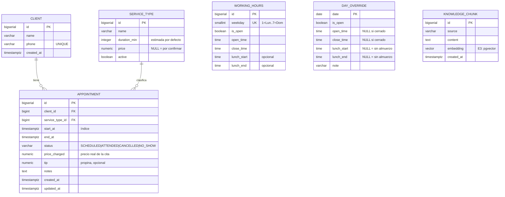

# Diagrama de base de datos (PostgreSQL)

## Notas

- `APPOINTMENT`: restricción anti-solapamiento
  `EXCLUDE USING gist (tstzrange(start_at, end_at) WITH &&)` **parcial** (`status <> 'CANCELLED'`):
  una cita cancelada no bloquea el horario. Citas contiguas (una termina justo cuando empieza la otra) SÍ se permiten.
- `end_at > start_at` siempre (CHECK).
- `WORKING_HOURS`: si `is_open` es falso, los horarios van NULL. `weekday` 1=Lunes..7=Domingo (como `java.time.DayOfWeek`).
- `KNOWLEDGE_CHUNK` llega en **E3** con la extensión `pgvector`; no está en la migración V1 (E1 es sin IA).
- Fechas en UTC (`timestamptz`); se muestran en `America/Bogota`.
