# Diagrama de clases — backend (E1)

```mermaid
classDiagram
    direction TB

    class AppointmentController
    class ScheduleController
    class ServicesController
    class AppointmentService
    class AvailabilityService
    class ScheduleService
    class DaySchedule
    class FreeSlot
    class ServiceCatalogService
    class ClientService
    class AppointmentRepository
    class ClientRepository
    class ServiceTypeRepository
    class WorkingHoursRepository
    class DayOverrideRepository
    class Appointment
    class Client
    class ServiceType
    class WorkingHours
    class DayOverride
    class AppointmentStatus {
        <<enumeration>>
        SCHEDULED
        ATTENDED
        CANCELLED
        NO_SHOW
    }

    AppointmentController --> AppointmentService : usa
    ScheduleController --> ScheduleService : usa
    ServicesController --> ServiceCatalogService : usa
    AppointmentService --> AvailabilityService : consulta huecos
    AppointmentService --> ScheduleService : valida horario
    AppointmentService --> AppointmentRepository
    AppointmentService --> ClientService : resuelve cliente
    AvailabilityService --> AppointmentRepository
    AvailabilityService --> ScheduleService : horario del día
    AvailabilityService --> FreeSlot : devuelve
    ScheduleService --> WorkingHoursRepository
    ScheduleService --> DayOverrideRepository
    ScheduleService --> DaySchedule : devuelve
    ServiceCatalogService --> ServiceTypeRepository
    ClientService --> ClientRepository
    AppointmentRepository --> Appointment
    ClientRepository --> Client
    ServiceTypeRepository --> ServiceType
    WorkingHoursRepository --> WorkingHours
    DayOverrideRepository --> DayOverride
    Appointment --> AppointmentStatus

    classDef controller fill:#87CEEB,stroke:#333,stroke-width:2px,color:darkblue
    classDef service fill:#90EE90,stroke:#333,stroke-width:2px,color:darkgreen
    classDef repository fill:#FFE4B5,stroke:#333,stroke-width:2px,color:darkorange
    classDef domain fill:#E6E6FA,stroke:#333,stroke-width:2px,color:darkblue
    class AppointmentController controller
    class ScheduleController controller
    class ServicesController controller
    class AppointmentService service
    class AvailabilityService service
    class ScheduleService service
    class DaySchedule service
    class FreeSlot service
    class ClientService service
    class ServiceCatalogService service
    class AppointmentRepository repository
    class ClientRepository repository
    class ServiceTypeRepository repository
    class WorkingHoursRepository repository
    class DayOverrideRepository repository
    class Appointment domain
    class Client domain
    class ServiceType domain
    class WorkingHours domain
    class DayOverride domain
    class AppointmentStatus domain
```

## Reglas de capas (de `AGENTS.md` y skill `capas-spring-boot`)

- Dependencias solo hacia abajo: `controller → service → repository → domain`.
- `ai.tools` (E3) llaman a `service`, nunca a `repository`.
- Controllers: reciben y devuelven DTOs (`record`), `@Valid`, sin lógica. Errores centralizados con
  `@RestControllerAdvice` → `{ code, message }`.
- Services: `@Transactional`, lanzan excepciones de dominio.

## Alcance de E1

- E1-T3..T5: `ScheduleService`, `AvailabilityService`, `AppointmentService`.
- E1-T8/T9 (después del núcleo de turnos): `ServiceCatalogService` y `StatsService` (precios y estadísticas).
